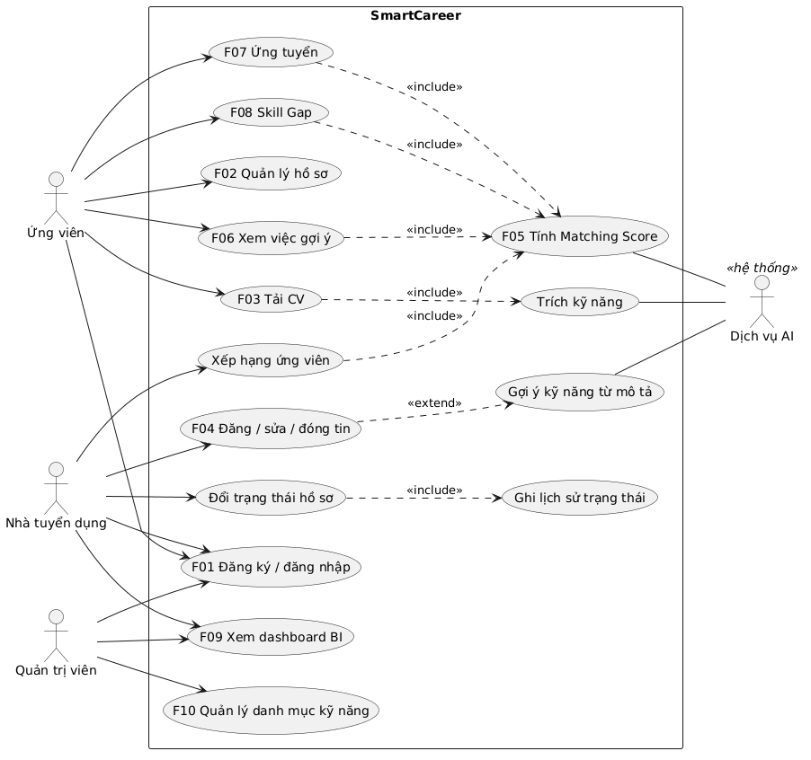
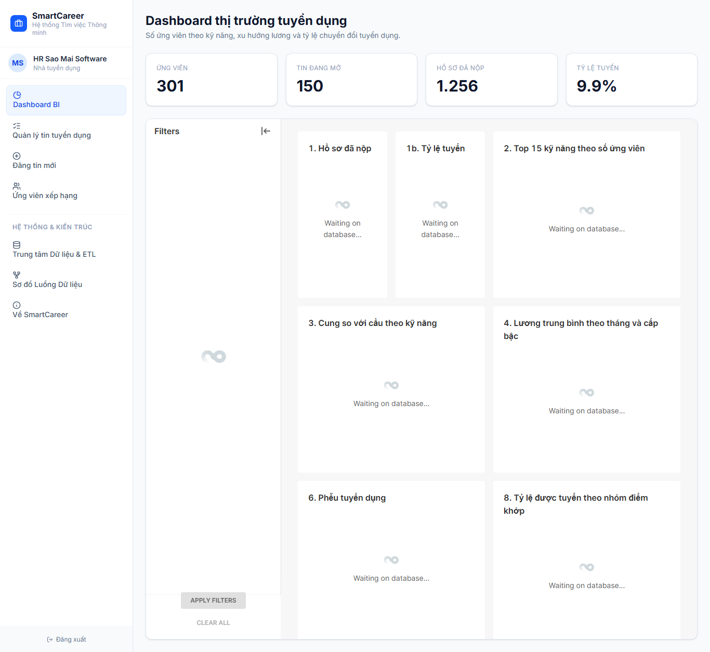

# TH3 – Xây dựng Hệ thống Tìm việc Thông minh tích hợp AI và BI (SmartCareer v2)

> Mọi số liệu về hệ thống, CSDL, API, BI và hiệu năng là số đo thật (nguồn ghi ở từng mục).
> **Nguồn nhãn đánh giá mô hình:** 300 cặp CV–JD (hai lượt) và nhãn kỹ năng 50 CV do **agent AI** gán, không phải do con người gán tay (`backend/seed/labels/NGUON_NHAN.md`). Các số ở chương 6 mang hạn chế này.

## 1. Giới thiệu

**Bài toán.** Sinh viên và người mới tốt nghiệp khó biết mình phù hợp vị trí nào và còn thiếu kỹ năng gì; nhà tuyển dụng phải sàng lọc nhiều hồ sơ chất lượng không đều.
**Mục tiêu.** Xây một nền tảng (1) tự động khớp kỹ năng ứng viên với yêu cầu công việc bằng điểm Matching Score *có giải thích*; (2) cung cấp dashboard BI cho nhà tuyển dụng về ứng viên theo kỹ năng, xu hướng lương và tỷ lệ chuyển đổi tuyển dụng; (3) kiểm thử và đánh giá hiệu quả mô hình gợi ý.
**Kế thừa.** Prototype React ở bài cá nhân (10 màn hình, dữ liệu mẫu, điểm khớp 60/25/15) được giữ làm baseline M0 và chế độ demo; bài này thêm backend, CSDL, mô hình AI/ML, BI và đánh giá.
**Kiến trúc.** 4 dịch vụ Docker Compose: `db` (PostgreSQL 16), `api` (FastAPI + tầng AI), `superset` (BI), `web` (React + nginx).

## 2. Phân tích yêu cầu và thiết kế CSDL (mục 01)

- Tác nhân, 10 chức năng F01–F10 và yêu cầu phi chức năng: `docs/report/01_phan_tich_yeu_cau.md`.
- Use Case:  Đặc tả 3 ca (Tải CV, Xem việc gợi ý, Đổi trạng thái): `docs/usecase/dac_ta_use_case.md`.
- ERD 15 bảng chia theo ba đối tượng của đề (ứng viên, nhà tuyển dụng, tin tuyển dụng) cộng đơn ứng tuyển và danh mục/AI: 
- DDL PostgreSQL: `backend/schema.sql` (sinh từ models, có test chống lệch); migration Alembic `0001` (15 bảng), `0002` (4 view BI), `0003` (cột `candidates.embedding`).
- Dữ liệu (hư cấu, seed cố định 42; không thu thập từ TopCV/LinkedIn): 108 kỹ năng, 259 từ đồng nghĩa, 30 công ty, 150 tin rải đều 12 tháng, 301 ứng viên, 50 CV PDF/DOCX có 5 bố cục, 1.255 đơn ứng tuyển kèm lịch sử trạng thái (`backend/seed/README.md`).

## 3. Mô hình AI (mục 02)

**Module A – CV Parser** (`backend/app/ai/parser.py`, `extract.py`): đọc PDF/DOCX/TXT; chuẩn hoá Unicode; tách mục song ngữ; trích kỹ năng 3 tầng (n-gram với từ điển và alias → so khớp mờ rapidfuzz ngưỡng 90 → embedding cosine ≥ 0,8 chỉ để đề xuất); số năm kinh nghiệm (gộp khoảng thời gian chồng nhau, bỏ mục học vấn); học vấn thang 1–4. Phần đầu CV (tên, tuổi, liên hệ) bị loại khỏi văn bản dùng chấm điểm để mô hình không dùng thông tin nhân thân.

**Module B – Matching Score** (`features.py`, `scorers.py`): 6 đặc trưng trong [0,1]: `skill_req`, `skill_pref`, `semantic` (cosine embedding `paraphrase-multilingual-MiniLM-L12-v2`), `exp`, `edu`, `pref`. Bảy phương pháp cùng giao diện (bốn hướng tiếp cận: luật, từ vựng cổ điển, ngữ nghĩa, học máy có giám sát):

| Mã | Phương pháp | Vai trò | Học máy? |
|---|---|---|---|
| M0 | Quy tắc 60/25/15 (port đúng `calculateSkillMatch`; khớp bản TypeScript 100% trên 84 ca) | Baseline kế thừa | Không |
| M1 | TF-IDF + cosine CV–JD | Baseline NLP cổ điển | Không (thống kê) |
| M2 | Chỉ embedding | Đo riêng ngữ nghĩa | Dùng mạng nơ-ron huấn luyện sẵn, không tự huấn luyện |
| M3 | Hybrid `0,40/0,15/0,25/0,10/0,05/0,05` + luật chặn ≤ 50 khi thiếu hơn nửa kỹ năng bắt buộc | Mặc định triển khai | Không (trọng số đặt tay) |
| M4 | **Logistic Regression** trên 6 đặc trưng; C chọn bằng GroupKFold lồng | Mô hình tuyến tính | **Có** |
| M5 | **Random Forest** (300 cây, độ sâu ≤ 4, `min_samples_leaf` 5, cân bằng lớp) trên 6 đặc trưng | Mô hình cây, bắt được tương tác giữa đặc trưng | **Có** |
| M6 | **Gradient Boosting** (150 cây nông, độ sâu 2, tốc độ học 0,05, subsample 0,8) trên 6 đặc trưng | Mô hình cây tăng cường | **Có** |

Ba mô hình học máy M4–M6 dùng cùng 6 đặc trưng, cùng nhãn nhị phân "phù hợp" (nhãn chốt ≥ 2) và cùng cách chia GroupKFold 5 theo ứng viên (một ứng viên không bao giờ vừa ở tập huấn luyện vừa ở tập kiểm tra). Siêu tham số của M5, M6 cố định từ trước (nông, có regularization vì chỉ có khoảng 300 cặp) và **không** dò trên dữ liệu kiểm tra; riêng C của M4 được chọn trong từng fold huấn luyện bằng GroupKFold lồng nên điểm kiểm tra không bị rò rỉ. Khi chấm cả lô tin, M4–M6 dự đoán một lần cho cả lô (chấm từng cặp một với Random Forest chậm hơn nhiều).

Mỗi lần chấm trả về điểm 0–100, 6 điểm thành phần, kỹ năng có/thiếu và một câu giải thích (ví dụ: "Khớp 72/100. Đã có React, Git. Thiếu TypeScript (bắt buộc) và REST API (ưu tiên).").

## 4. Dashboard BI (mục 03)

Ba chỉ số của đề bài đều có view SQL (`bi/views.sql`), API dự phòng (`/api/bi/*`) và biểu đồ Superset:

| Chỉ số | View | Biểu đồ |
|---|---|---|
| Số ứng viên theo kỹ năng | `v_skill_supply_demand` | 2 (bắt buộc), 3 |
| Xu hướng lương | `v_salary` | 4 (bắt buộc) |
| Tỷ lệ chuyển đổi tuyển dụng | `v_funnel`, `v_funnel_stages` | 6 (bắt buộc), 1, 8 |

Phễu đếm hồ sơ *từng đạt* mỗi bước từ `application_status_history` (không đếm theo trạng thái hiện tại). Dashboard nhúng vào trang nhà tuyển dụng bằng guest token; RLS `company_id` làm mỗi công ty chỉ thấy số của mình.

**Đã kiểm chứng thật (PostgreSQL 16 + Superset 4.1.1):** 4 view khớp API từng con số (`scripts/check_bi_views.py`); công ty 1 thấy 19 hồ sơ, công ty 5 thấy 63, quản trị thấy 1.255 qua guest token; `bi_reader` chỉ đọc được view. Ảnh:  Tệp xuất `bi/superset/dashboard_export.zip` nhập lại được.

**Nhận định** (đầy đủ ở `bi/NHAN_DINH.md`; dữ liệu mô phỏng nên chỉ minh hoạ cách đọc): chuyển đổi tổng 9,9% (124/1.255), trung vị 16,4 ngày đến khi tuyển; bước rơi lớn nhất là từ phỏng vấn lên đề nghị (39,4%); Jira và Viết test case có cầu bằng cung (15 ứng viên/15 tin); lương trung vị tăng ở mọi cấp bậc (senior +15% … intern +2%) do trình sinh gài xu hướng; tỷ lệ tuyển theo nhóm điểm khớp chênh nhỏ vì dữ liệu mô phỏng không gắn kết quả với điểm.

## 5. Kiến trúc, API và giao diện (mục 04)

- **API** (Swagger `/docs`): xác thực JWT + phân quyền 3 vai trò; hồ sơ, tải CV (415/413/422/400 cho lỗi), tin, ứng tuyển với luật trạng thái `applied → screening → interview → offer → hired` (sai luật trả 409), việc đã lưu, AI (`/ai/match`, `/candidates/me/matches`, `/recommendations`, `/skill-gap`, `/jobs/{id}/ranked-candidates`, `/ai/extract-skills`), BI, quản trị danh mục (`docs/00_KE_HOACH_KY_THUAT_TH3.md` mục 3.4).
- **Giao diện:** đăng nhập/đăng ký; ứng viên: Tổng quan, Tìm việc, Phân tích CV–JD (chọn M0–M4, 6 thành phần, giải thích), Skill Gap, hồ sơ + tải CV, Việc đã lưu & Ứng tuyển; nhà tuyển dụng: Dashboard BI, Quản lý tin, Đăng tin (có gợi ý kỹ năng), Kanban 6 cột; quản trị: Quản lý kỹ năng. Mọi trang có trạng thái tải/lỗi/rỗng. Chế độ demo (`VITE_OFFLINE_DEMO=true`) chạy không cần backend.
- Ảnh các màn hình: tạo bằng `python scripts/e2e_smoke.py --shots <thư mục>` (14 ảnh).
- **Hiệu năng đo qua HTTP trên PostgreSQL + model thật:** chấm 1 cặp 38 ms (yêu cầu < 200 ms); 150 tin 38 ms; 500 tin 70–77 ms (yêu cầu < 2 s). Nhờ embedding hồ sơ, CV và tin được tính sẵn khi lưu; trước khi bổ sung cột `candidates.embedding`, chấm 1 cặp mất 417 ms.

## 6. Thực nghiệm và đánh giá (mục 05)

### 6.1. Dữ liệu và cách gán nhãn
30 ứng viên theo nhóm nghề × 10 tin (4 cùng nhóm, 3 gần, 3 khác nhóm) = 300 cặp; thang 0–3 theo `docs/report/huong_dan_gan_nhan.md`; nhãn nhị phân "phù hợp" khi ≥ 2.

**Nhãn do agent AI gán.** Hai phiên agent AI (Claude Sonnet) riêng biệt gán độc lập 300 cặp, mỗi phiên chỉ nhận mô tả cặp và hướng dẫn, không xem điểm hệ thống hay nhãn của phiên kia; 50 CV được một phiên khác đọc văn bản để gán kỹ năng. Chi tiết và hạn chế: `backend/seed/labels/NGUON_NHAN.md`.

Kết quả: kappa có trọng số bình phương = **0,959** (mục tiêu ≥ 0,6), trùng khít 89% cặp, **0** cặp lệch ≥ 2 bậc, 29,7% cặp "phù hợp". Kappa cao phản ánh việc hai phiên dùng cùng họ mô hình và cùng tiêu chí, nên là độ nhất quán của agent chứ không phải độ tin cậy giữa hai người; chưa có đối chiếu với nhãn của con người.

### 6.2. Kiểm thử hệ thống
- 247 test tự động (pytest): parser, đặc trưng, M0–M6, phân quyền, luật trạng thái, phễu BI, seed, migration, hiệu năng; M0 khớp TypeScript 100%; bộ test chạy lại trong container với model thật (223 đạt, 2 bỏ qua do thiếu file ngoài image).
- 44 test case theo F01–F10 và phi chức năng: `docs/testcases.md` (ca nào đã chạy thật ghi rõ).
- E2E trình duyệt: 14/14 bước trên stack Docker thật (ứng viên, nhà tuyển dụng, quản trị); chế độ demo 12/12 bước, 0 lời gọi API.
- Công bằng: hai CV chỉ khác phần đầu (tên, giới tính, tuổi, email) cho cùng kỹ năng, năm kinh nghiệm, học vấn và cùng điểm M3 (67).

### 6.3. Đánh giá Module A (CV Parser) – 50 CV (nhãn do agent AI gán)
| Tầng | Precision | Recall | F1 |
|---|---|---|---|
| T1 từ điển + alias | 0,969 | 0,989 | 0,979 |
| T1+2 (+ so khớp mờ) | 0,963 | 0,993 | 0,978 |
| T1+2+3 (+ embedding) | 0,963 | 0,993 | 0,978 |

MAE số năm kinh nghiệm = 0,022. Nhận xét: tầng 2 và 3 không cải thiện F1 (tăng recall nhẹ, giảm precision) vì CV mẫu ít lỗi gõ và gần như không có cụm ngoài từ điển; CV là dữ liệu tổng hợp nên con số này cao hơn so với CV thật.

### 6.4. So sánh M0–M6 trên 30 ứng viên × 10 tin (M4–M6 tính trên fold kiểm tra GroupKFold; nhãn do agent AI gán)
| Mô hình | Precision@5 | nDCG@10 | MRR | Spearman ρ | ROC-AUC | ms/cặp |
|---|---|---|---|---|---|---|
| M0 quy tắc 60/25/15 | 0,573 | 0,970 | 0,742 | 0,851 | 0,967 | 0,08 |
| M1 TF-IDF | 0,560 | 0,962 | 0,717 | 0,820 | 0,902 | 7,36 |
| M2 embedding | 0,547 | 0,954 | 0,714 | 0,785 | 0,842 | 0,10 |
| M3 hybrid | 0,580 | 0,988 | 0,800 | 0,836 | 0,984 | 0,12 |
| M4 Logistic Regression | 0,580 | 0,971 | 0,800 | 0,822 | 0,977 | — |
| M5 Random Forest | 0,580 | **0,989** | 0,800 | **0,851** | 0,981 | — |
| M6 Gradient Boosting | 0,573 | 0,983 | 0,778 | 0,827 | 0,967 | — |

**Khoảng tin cậy 95% bằng bootstrap theo ứng viên** (500 lần resample cả ứng viên; `docs/report/tables/ndcg_bootstrap.csv`):

| Mô hình | nDCG@10 | Khoảng tin cậy 95% | Chênh lệch so với M3 | Khoảng tin cậy của chênh lệch | Khác M3 có ý nghĩa? |
|---|---|---|---|---|---|
| M0 | 0,970 | 0,953 – 0,985 | −0,018 | −0,036 đến −0,002 | **Có** (kém hơn) |
| M1 | 0,962 | 0,943 – 0,981 | −0,026 | −0,047 đến −0,005 | **Có** (kém hơn) |
| M2 | 0,954 | 0,933 – 0,974 | −0,034 | −0,057 đến −0,012 | **Có** (kém hơn) |
| M3 | 0,988 | 0,982 – 0,994 | — | — | — |
| M4 | 0,971 | 0,943 – 0,991 | −0,017 | −0,042 đến +0,002 | Không (khoảng chứa 0) |
| M5 | 0,989 | 0,981 – 0,994 | +0,000 | −0,008 đến +0,008 | Không |
| M6 | 0,983 | 0,972 – 0,993 | −0,005 | −0,018 đến +0,006 | Không |

Nhận xét: (1) Có hai nhóm. M3, M5 (và M6) đứng đầu, M0, M1, M2 kém hơn M3 một cách có ý nghĩa thống kê. (2) Giữa M3 và các mô hình học máy M4–M6 **không** phân biệt được: khoảng tin cậy của chênh lệch đều chứa 0, nên không thể nói mô hình học máy tốt hơn hay kém hơn mô hình lai đặt tay. M5 (Random Forest) có nDCG@10 và Spearman nhỉnh nhất nhưng chỉ hơn M3 0,0002, không đáng kể. (3) Việc chọn C cho M4 bằng GroupKFold lồng (C = 10 trên toàn bộ dữ liệu) **không cải thiện**: ROC-AUC kiểm tra 0,977 so với 0,981 khi giữ C = 1, nằm trong sai số. (4) Chỉ có 30 ứng viên, và agent gán nhãn dựa trên đúng loại thông tin các mô hình dùng nên các con số có xu hướng lạc quan; cần nhãn của con người để kết luận chắc chắn. (5) Điểm mạnh của mô hình cây, bắt được tương tác phi tuyến giữa các đặc trưng, có kiểm chứng ở mức kiểm thử đơn vị trên dữ liệu tổng hợp (`test_tree_models_capture_interaction_that_logreg_cannot`), nhưng với 6 đặc trưng và bộ nhãn hiện có, mô hình cây không cho lợi thế đo được so với mô hình tuyến tính (chưa kiểm chứng nguyên nhân).

### 6.5. Ablation M3 (bỏ lần lượt một đặc trưng, đo nDCG@10) và hệ số M4
| Bỏ đặc trưng | nDCG@10 | Thay đổi |
|---|---|---|
| (không bỏ) | 0,988 | — |
| `skill_req` | 0,928 | −0,060 |
| `skill_pref` | 0,968 | −0,021 |
| `semantic` | 0,978 | −0,011 |
| `exp` | 0,977 | −0,011 |
| `edu` | 0,989 | +0,000 |
| `pref` | 0,989 | +0,000 |

Độ quan trọng của đặc trưng sau khi huấn luyện trên toàn bộ dữ liệu (`docs/report/tables/m4_coefficients.csv`):

| Đặc trưng | M4 hệ số (C = 10) | M5 độ quan trọng | M6 độ quan trọng | Trọng số tay M3 |
|---|---|---|---|---|
| `skill_req` | 10,82 | 0,638 | 0,802 | 0,40 |
| `semantic` | 4,34 | 0,244 | 0,069 | 0,25 |
| `exp` | 2,81 | 0,047 | 0,103 | 0,10 |
| `edu` | 2,41 | 0,009 | 0,007 | 0,05 |
| `skill_pref` | 2,32 | 0,050 | 0,012 | 0,15 |
| `pref` | −0,55 | 0,012 | 0,007 | 0,05 |

Cả ba mô hình học máy đều cho `skill_req` quan trọng nhất, rồi đến `semantic`, cùng thứ tự với trọng số tay của M3 ở hai đặc trưng đầu; `pref` gần như không đóng góp ở cả ba mô hình. (Hệ số của M4 không so trực tiếp với độ quan trọng của cây vì khác thang.)

### 6.6. Phân tích lỗi (5 cặp lệch nhiều nhất của M3)
Hai cặp của cand-0082 (nhãn 3, điểm 49–50) bị M3 chặn ≤ 50 vì ứng viên chỉ có Node.js trong số kỹ năng bắt buộc (thiếu SQL, REST API, OOP); agent vẫn gán 3, nhiều khả năng vì ứng viên đúng hướng Node.js Developer, nghĩa là nhãn này cứng tay hoặc mô hình thiếu đặc trưng "đúng nhóm nghề". Ba cặp còn lại (cand-0068 và cand-0285, nhãn 0, điểm 48–50) được chấm gần 50 chỉ vì trùng kỹ năng mềm/SQL cơ bản với tin khác nhóm nghề. Hướng cải thiện: thêm đặc trưng nhóm nghề và kiểm tra lại nhãn các cặp này với con người (`docs/report/tables/error_analysis_m3.csv`).

## 7. Hạn chế và hướng phát triển
- Dữ liệu ứng viên, CV, tin và đơn ứng tuyển là mô phỏng; xu hướng lương và tỷ lệ tuyển chỉ minh hoạ cách tính.
- Nhãn đánh giá do agent AI gán, chưa đối chiếu với con người; `models_store/m4.joblib` (phiên bản `m4-ai-labels`) huấn luyện trên nhãn này, giao diện hiện ghi chú nguồn nhãn. Chỉ 30 ứng viên nên kết luận chỉ mang tính tham khảo.
- Trích kỹ năng CV chủ yếu là từ điển + so khớp mờ + embedding; chưa có mô hình nhận dạng thực thể huấn luyện riêng (hướng: PhoBERT/NER).
- CV dạng ảnh scan không đọc được (hệ thống báo lỗi, không đoán).
- Hướng phát triển: học từ phản hồi thật của nhà tuyển dụng, thêm đặc trưng nhóm nghề, giao diện quản lý tin cho quản trị, Native Filters và biểu đồ 5, 7 của Superset.
