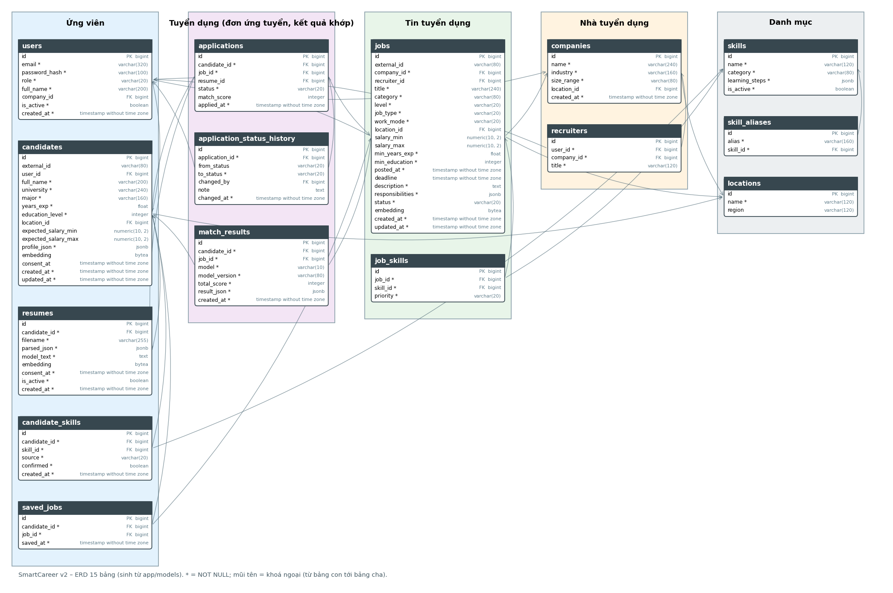

# TH3 – Xây dựng Hệ thống Tìm việc Thông minh tích hợp AI và BI (SmartCareer v2)

> Bản ghép của Hoàng Anh. Chương 1, 2, 6 (kiểm thử), 7 do Hoàng Anh viết; các chương còn lại ghi nguồn và `TODO` cho đến khi tác giả giao bản viết (hạn 12:00 06/11; chương AI 18:00 06/11). Số liệu AI/BI chỉ lấy từ file kết quả của Tùng/Hưng, thiếu thì để `TODO`, không tự điền.
> Mọi dữ liệu ứng viên, CV, tin và đơn ứng tuyển là **mô phỏng** (seed cố định 42, tên hư cấu).

## 1. Giới thiệu

**Bài toán.** Sinh viên và người mới tốt nghiệp khó biết mình phù hợp vị trí nào và còn thiếu kỹ năng gì; nhà tuyển dụng phải sàng lọc nhiều hồ sơ chất lượng không đều và thiếu số liệu để tối ưu quy trình.

**Mục tiêu.** Xây một nền tảng (1) tự động khớp kỹ năng ứng viên với yêu cầu công việc bằng điểm Matching Score *có giải thích*; (2) cung cấp dashboard BI cho nhà tuyển dụng: số ứng viên theo kỹ năng, xu hướng lương, tỷ lệ chuyển đổi tuyển dụng; (3) kiểm thử và đánh giá hiệu quả mô hình gợi ý.

**Kế thừa SmartCareer.** Prototype React ở bài cá nhân (10 màn hình, dữ liệu mẫu, điểm khớp theo quy tắc 60/25/15) được giữ làm baseline M0 và chế độ demo (`VITE_OFFLINE_DEMO=true`). Bài này thêm backend FastAPI, PostgreSQL, mô hình AI/ML (M0–M4), dashboard Superset và đánh giá.

**Kiến trúc.** Bốn dịch vụ Docker Compose: `db` (PostgreSQL 16), `api` (FastAPI + tầng AI), `superset` (BI), `web` (React + nginx).

## 2. Phân tích yêu cầu và thiết kế CSDL (mục 01)

### 2.1. Yêu cầu
Bốn tác nhân (ứng viên, nhà tuyển dụng, quản trị, dịch vụ AI), mười chức năng F01–F10 và yêu cầu phi chức năng: xem `docs/report/01_phan_tich_yeu_cau.md` (bảng đầy đủ, đưa vào báo cáo bản cuối).

### 2.2. Use Case

Ba quan hệ `<<include>>` chính: *Tải CV* → *Trích kỹ năng*; *Xem việc gợi ý* → *Tính Matching Score*; *Đổi trạng thái* → *Ghi lịch sử trạng thái*. Đặc tả chi tiết ba use case (Tải CV, Xem việc gợi ý, Đổi trạng thái ứng tuyển, gồm luật chuyển và lỗi 409): `docs/usecase/dac_ta_use_case.md`.

### 2.3. ERD

15 bảng chia theo ba đối tượng của đề (ứng viên, nhà tuyển dụng, tin tuyển dụng) cộng nhóm tuyển dụng (đơn ứng tuyển, kết quả khớp) và danh mục. Giải thích quan hệ và ràng buộc: `docs/erd/giai_thich_erd.md`. Chương CSDL, migration, seed do Thái Anh viết: `docs/report/chuong_csdl_kien_truc_api.md`.

## 3. Mô hình AI (mục 02)
TODO – chương của Tùng (CV parser, 6 đặc trưng, M0–M4, bảng P/R/F1, bảng so sánh M0–M4, ablation, công bằng). Chưa có file kết quả trong `docs/report/tables/` nên không điền số liệu.

## 4. Dashboard BI (mục 03)
TODO – chương của Hưng (ba chỉ số của đề, biểu đồ, nhận định). Dữ liệu ứng tuyển là mô phỏng: biểu đồ phễu minh hoạ cách tính, không chứng minh mô hình tốt.

## 5. Kiến trúc, API và giao diện (mục 04)
Phần API, kiến trúc: `docs/report/chuong_csdl_kien_truc_api.md` (Thái Anh). TODO – phần giao diện và ảnh màn hình của Ngọc Anh.

## 6. Kiểm thử và đánh giá (mục 05)

### 6.1. Kiểm thử tự động
Lần chạy gần nhất (nhánh `feat/hoanganh-phan-tich-bao-cao`, từ `origin/main`): `pytest backend/tests` → **178 passed** khi có PostgreSQL 16 tạm (11 test API cần `TEST_DATABASE_URL`); không có thì 167 passed, 1 skipped. Phủ: parser CV, đặc trưng, M0–M3 và nạp M4, phân quyền (401/403), luật trạng thái (409), tải CV (400/413/415/422), phân trang tin, M0 khớp bản TypeScript trên 84 ca, công bằng khi đổi phần đầu CV, hiệu năng 500 tin < 2 giây (dữ liệu tổng hợp, embedder băm).

### 6.2. Test case thủ công
33 ca theo F01–F10 và phi chức năng: `docs/testcases.md`. Hiện **20/33 ca đạt bằng kiểm thử tự động; 13 ca chưa chạy** (giao diện, Docker, Superset). TODO: chạy 13 ca, ghi kết quả thật và ảnh, cập nhật số này (hạn 4/11).

### 6.3. Đối chiếu BI
TODO – đối chiếu ba chỉ số BI với truy vấn SQL tay (`scripts/check_bi_views.py`) sau khi Hưng/Thái Anh giao dashboard.

### 6.4. Đánh giá mô hình
TODO – đưa bảng từ `docs/report/tables/` của Tùng. Nhãn (300 cặp CV–JD, 50 CV) chưa có trong repo: `backend/seed/labels/` đang trống và `backend/seed/cv_files/` chưa có CV; không kết luận hiệu quả mô hình khi chưa có nhãn.

## 7. Hạn chế và hướng phát triển
- Dữ liệu ứng viên, CV, tin và đơn ứng tuyển là mô phỏng; xu hướng lương và tỷ lệ tuyển chỉ minh hoạ cách tính.
- Hiệu quả mô hình chỉ kết luận được từ nhãn gán tay; cỡ mẫu nhỏ (30 ứng viên × 10 tin) nên chênh lệch nhỏ giữa các mô hình không có ý nghĩa thống kê.
- Trích kỹ năng chủ yếu là từ điển + so khớp mờ + embedding; chưa có mô hình nhận dạng thực thể huấn luyện riêng (hướng: PhoBERT/NER).
- CV dạng ảnh scan không đọc được (hệ thống báo lỗi `no_text`, không đoán).
- Hướng phát triển: học từ phản hồi thật của nhà tuyển dụng; thêm đặc trưng nhóm nghề; mở rộng danh mục kỹ năng; thêm Native Filters và biểu đồ còn lại của Superset.
