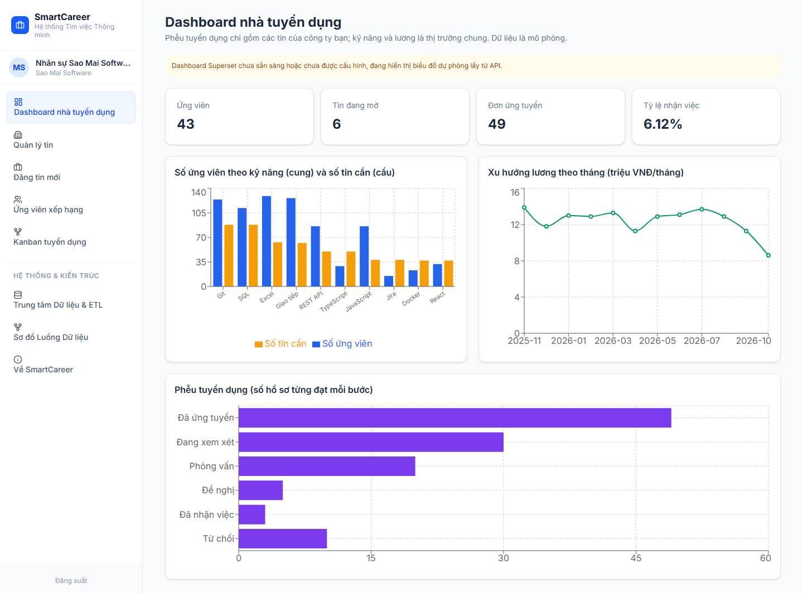

# Chương BI – Dashboard phân tích thị trường và tuyển dụng (mục checklist 03)

> Bản nháp soạn từ mã và dữ liệu trên `main`. Số liệu lấy từ hệ thống đã nạp seed cố định 42 (`python -m seed.load_seed --reset`) và đối chiếu bằng `scripts/check_bi_views.py`. **Dữ liệu ứng tuyển và lương là mô phỏng**: biểu đồ chỉ minh hoạ cách tính, không phản ánh thị trường thật. Phần Superset nhúng chưa có dashboard nên chưa kiểm (xem mục 6).

## 1. Ba chỉ số của đề bài

| Chỉ số | Định nghĩa | Nguồn |
|---|---|---|
| Số ứng viên theo kỹ năng | với mỗi kỹ năng: số ứng viên có kỹ năng đã xác nhận (cung) và số tin đang mở yêu cầu kỹ năng đó (cầu) | `v_skill_supply_demand` |
| Xu hướng lương | lương tối thiểu và tối đa trung bình của tin đang mở theo địa điểm, nhóm nghề, cấp bậc và tháng đăng; đơn vị triệu VNĐ/tháng | `v_salary` |
| Tỷ lệ chuyển đổi tuyển dụng | số hồ sơ **từng đạt** mỗi bước applied → screening → interview → offer → hired (và rejected) và tỷ lệ chuyển giữa các bước | `v_funnel`, `v_funnel_stages` |

Phễu đếm theo **lịch sử trạng thái** (`application_status_history`), không theo trạng thái hiện tại: một hồ sơ đã `hired` vẫn được tính ở các bước `interview` và `offer` mà nó đã đi qua. Nếu đếm theo trạng thái hiện tại thì các bước giữa sẽ bị đếm thiếu.

## 2. Bốn view SQL

Định nghĩa nằm ở `bi/views.sql`, được tạo trong migration `0002_views`.

| View | Nội dung |
|---|---|
| `v_skill_supply_demand` | `skill_id, skill_name, category, candidate_count, open_job_count` |
| `v_salary` | `location, category, level, posted_month, job_count, average_salary_min/max, minimum_salary, maximum_salary` |
| `v_funnel` | một dòng mỗi công ty: `company_id, applied, screening, interview, offer, hired, rejected, total_applications` |
| `v_funnel_stages` | một dòng mỗi công ty và mỗi bước: `stage, stage_order, applications, conversion_rate` (phục vụ biểu đồ Funnel); tỷ lệ chuyển của `rejected` tính trên số hồ sơ nộp |

**Quyền truy cập:** role `bi_reader` chỉ có `SELECT` trên bốn view này (không đọc được bảng gốc). Nhà tuyển dụng chỉ thấy phễu của công ty mình: API lọc theo `company_id`, và với Superset thì guest token gắn điều kiện `company_id = <công ty>` (Row Level Security) cho **cả** `v_funnel` và `v_funnel_stages`. Nếu chưa cấu hình id dataset, backend từ chối cấp token (503 `superset_not_configured`) thay vì cấp token không lọc.

**Lỗi đã gặp khi dựng migration:** câu lệnh trong `views.sql` được tách theo dấu `;`, nên phải bỏ chú thích `--` trước khi tách (một chú thích chứa `;` làm hỏng câu lệnh); lỗi này không lộ ra khi test bằng SQLite mà chỉ lộ trên PostgreSQL thật.

## 3. API BI

`GET /api/bi/summary`, `/bi/skills`, `/bi/salary`, `/bi/funnel` (đọc bốn view; funnel lọc theo công ty của nhà tuyển dụng, quản trị viên thấy tất cả) và `GET /api/bi/guest-token` (token nhúng Superset). Chỉ nhà tuyển dụng và quản trị viên được gọi; ứng viên nhận 403.

**Đối chiếu số liệu:** `scripts/check_bi_views.py` so từng view với endpoint tương ứng trên PostgreSQL thật. Kết quả lần chạy: cả bốn view (`v_skill_supply_demand`, `v_salary`, `v_funnel`, `v_funnel_stages`) **khớp** với API.

## 4. Biểu đồ và số liệu

Giao diện nhà tuyển dụng (`/employer/dashboard`) có bốn thẻ tổng quan và ba biểu đồ. Khi Superset chưa cấu hình, giao diện hiển thị các biểu đồ dự phòng lấy từ API và ghi chú rõ như vậy (hình ở mục 6 của chương giao diện).

Số liệu trên dữ liệu mô phỏng (150 tin đang mở, 300 ứng viên, 1.200 đơn):

**Cung – cầu kỹ năng (toàn thị trường).** Kỹ năng có nhiều tin yêu cầu nhất: Git và SQL (88 tin mỗi kỹ năng), Excel (63), Giao tiếp (62), REST API và TypeScript (50 mỗi kỹ năng). Tỷ lệ cầu trên cung cao nhất: BPMN (25 tin / 8 ứng viên), Jira (38 / 15), Agile/Scrum (24 / 13), TypeScript (50 / 29), Power BI (25 / 15) – tức các kỹ năng khan hiếm so với nhu cầu. Mỗi kỹ năng trong danh mục đều có ít nhất một ứng viên.

**Xu hướng lương.** Lương trung điểm trung bình theo cấp bậc: intern 4,1; fresher 9,9; junior 13,2; middle 16,3; senior 19,2 (triệu VNĐ/tháng) – tăng đều theo cấp bậc. Theo tháng đăng, mức trung bình dao động quanh 11–14 triệu và giảm ở tháng 10/2026 (8,6 triệu), vì tháng đó có 23 tin (khoảng gấp đôi các tháng khác, 11–12 tin) và 17/23 tin là intern hoặc fresher; đây là hiệu ứng cơ cấu của dữ liệu mô phỏng, không phải xu hướng lương thật.

**Phễu tuyển dụng.** Toàn thị trường: 1.200 nộp → 753 xem xét → 427 phỏng vấn → 168 đề nghị → 65 nhận việc (5,4%), 251 bị từ chối. Công ty 1 (Sao Mai Software): 49 → 30 → 20 → 5 → 3 (6,1%), 10 từ chối. Công ty 5: 39 → 24 → 13 → 4 → 1, 7 từ chối. Hai công ty cho phễu khác nhau, chứng tỏ bộ lọc theo công ty hoạt động.

## 5. Nhận định (rút từ số liệu mô phỏng)

1. **Kỹ năng thiếu người nhất không phải kỹ năng phổ biến nhất.** Git và SQL có nhiều tin nhất nhưng cũng nhiều ứng viên; BPMN, Jira và Agile có tỷ lệ cầu/cung cao nhất, đáng ưu tiên khi ứng viên chọn kỹ năng học thêm (liên quan trang Skill Gap).
2. **Lương tăng rõ theo cấp bậc,** gấp khoảng 4,7 lần từ intern lên senior; biến động theo tháng nhỏ và không có xu hướng rõ ràng.
3. **Bước rơi nhiều nhất của phễu là từ "nộp" sang "xem xét"** (1.200 → 753, tức rơi 37%) rồi từ "xem xét" sang "phỏng vấn" (753 → 427). Tỷ lệ nhận việc chung là 5,4%.
4. **Không rút ra kết luận về chất lượng mô hình khớp từ dashboard.** Xác suất chuyển bước của đơn mô phỏng được sinh ngẫu nhiên, không phụ thuộc điểm khớp; vì vậy mọi biểu đồ "tỷ lệ tuyển theo nhóm điểm" chỉ minh hoạ cách tính. Hiệu quả của mô hình chỉ được đánh giá ở chương AI.

## 6. Superset và việc còn lại

- Hạ tầng Superset 4.1 đã khai báo trong `docker-compose.yml` (metadata riêng `superset_meta`, kết nối dữ liệu bằng `bi_reader`, bật `EMBEDDED_SUPERSET`, CORS, cho nhúng từ cổng 5173 và 8080). Endpoint guest token và RLS đã có mã nhưng **chưa kiểm với Superset thật** vì chưa có dashboard.
- TODO (Hưng): dựng dashboard "Thị trường tuyển dụng" trên Superset với ba biểu đồ bắt buộc (2: Top 15 kỹ năng theo số ứng viên; 4: trung vị lương theo tháng và cấp bậc; 6: phễu 5 bước) cộng ít nhất hai biểu đồ mở rộng; xuất `bi/superset/dashboard_export.zip` và kiểm tra nhập lại được; chụp ảnh dashboard; đối chiếu số trên dashboard với bảng ở mục 4.
- TODO (Thái Anh): điền id dataset `v_funnel`, `v_funnel_stages` và UUID dashboard vào `.env` (`SUPERSET_DASHBOARD_ID`, `SUPERSET_FUNNEL_DATASET_ID`, `SUPERSET_FUNNEL_STAGES_DATASET_ID`), rồi kiểm tra guest token của hai công ty cho số khác nhau đúng như `/api/bi/funnel`.
- Biểu đồ Recharts dự phòng dùng trung điểm của khoảng lương trung bình thay cho "trung vị lương" của biểu đồ 4 trong Superset; hai cách tính này khác nhau, cần ghi rõ khi so sánh.
