# Chương Giao diện – Frontend và tích hợp API AI/BI (mục checklist 04)

> Các ảnh trong chương được chụp tự động ngày 06/11/2026 từ hệ thống chạy thật của nhánh `fix/main-chuan-checklist` (Docker Compose, PostgreSQL 16, Superset, dữ liệu mô phỏng). Tên người trong ảnh là hư cấu.

## 1. Công nghệ và kiến trúc

React 19, Vite, TypeScript (`erasableSyntaxOnly`, `verbatimModuleSyntax`), Tailwind 4, `react-router-dom` 7, Recharts và `axios`. Giao diện là phần mở rộng của prototype SmartCareer bài trước: giữ nguyên các màn hình cũ và bổ sung lớp gọi API, đăng nhập, phân quyền và các màn của nhà tuyển dụng, quản trị viên.

| Lớp | Thư mục | Việc |
|---|---|---|
| Gọi API | `src/api/` | `client.ts` (axios, gắn `Authorization: Bearer`, tự đăng xuất khi 401), một tệp cho mỗi nhóm API, `adapters.ts` chuyển JSON của backend sang kiểu của frontend |
| Trạng thái | `src/context/`, `src/hooks/useAppState.ts` | `AuthContext` (đăng nhập, vai trò), `JobsContext` (danh sách tin và điểm khớp), `useAppState` (hồ sơ, đơn, tin đã lưu) |
| Trang | `src/pages/` | các màn theo vai trò |
| Thành phần | `src/components/` | thẻ tin, modal, form đăng tin, `LoadingBlock`, `ErrorBlock`, `EmptyBlock` |

**Hai chế độ chạy:**

- **Online** (mặc định): gọi API qua `VITE_API_URL` (mặc định `/api`, nginx chuyển tiếp tới backend). Dữ liệu và điểm khớp lấy từ máy chủ; ứng tuyển, lưu tin và hồ sơ được lưu trong cơ sở dữ liệu.
- **Demo offline** (`VITE_OFFLINE_DEMO=true`): chạy trọn không cần backend, bằng dữ liệu mẫu; **không gửi lời gọi API nào** (có kiểm tra tự động). Đăng nhập bằng email bất kỳ: bắt đầu bằng `hr` để xem màn nhà tuyển dụng, `admin` để xem màn quản trị. Đây là phương án dự phòng khi trình diễn.

## 2. Phân quyền và điều hướng

Đăng ký/đăng nhập bằng email và mật khẩu (JWT). Người dùng được đưa tới màn đầu tiên đúng vai trò; truy cập trang không thuộc vai trò hiển thị "Bạn không có quyền truy cập trang này". Không có đường tự đăng ký quản trị viên; nhà tuyển dụng phải nhập tên công ty khi đăng ký.

| Vai trò | Màn hình |
|---|---|
| Ứng viên | Tổng quan `/`, Tìm việc `/jobs`, Phân tích CV–JD `/match`, Skill Gap `/skill-gap`, Việc đã lưu & Ứng tuyển `/applications`, Hồ sơ `/profile` |
| Nhà tuyển dụng | Dashboard `/employer/dashboard`, Quản lý tin `/employer/jobs`, Đăng tin `/employer/jobs/new`, Sửa tin `/employer/jobs/:id/edit`, Ứng viên xếp hạng `/employer/candidates`, Kanban `/employer/kanban` |
| Quản trị viên | Quản lý kỹ năng `/admin/skills` |
| Chung | Luồng dữ liệu (ETL), Sơ đồ luồng dữ liệu (DFD), Về SmartCareer |

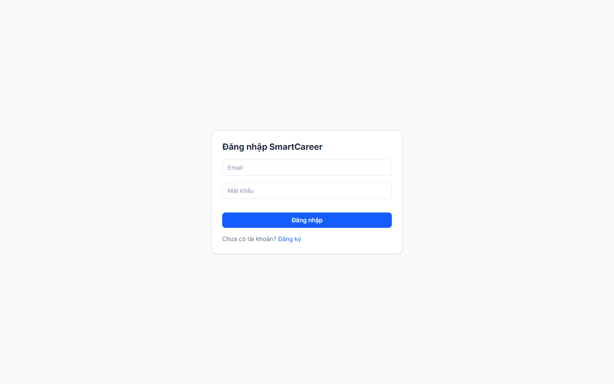

## 3. Giao diện ứng viên

**Tổng quan** hiển thị số việc phù hợp, tiến độ hồ sơ, danh sách việc phù hợp nhất và gợi ý học kỹ năng, lấy từ API điểm khớp.

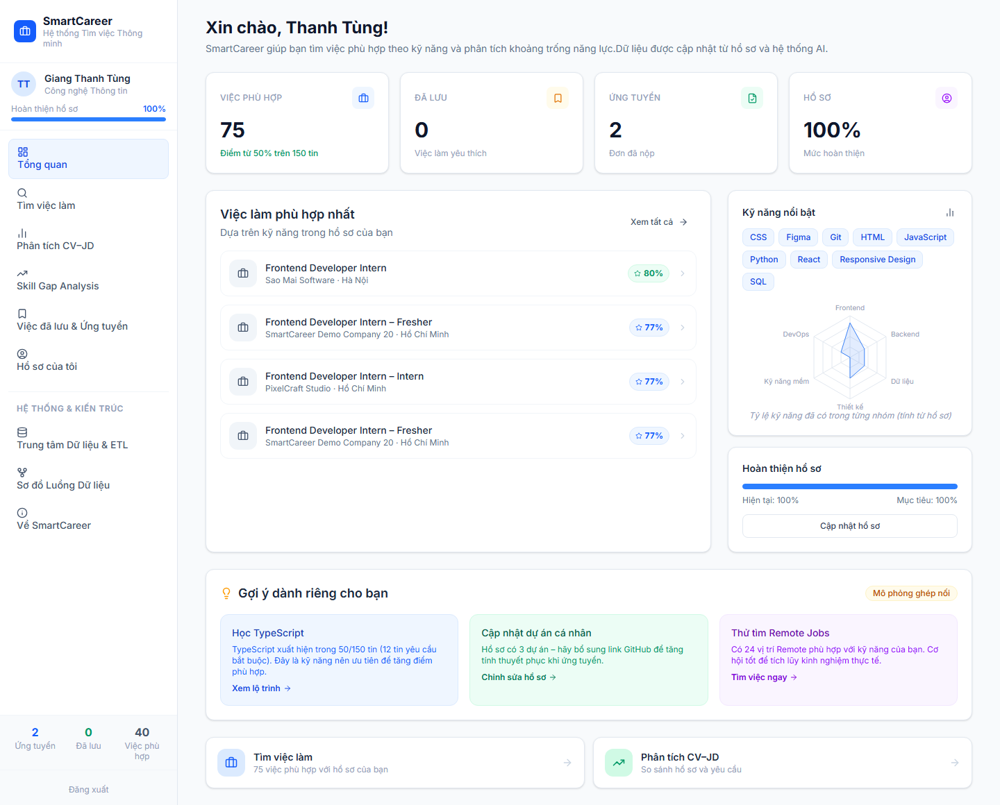

**Tìm việc** liệt kê toàn bộ 150 tin (tự tải nhiều trang vì backend giới hạn 100 tin mỗi trang), có bộ lọc và hiển thị điểm khớp trên từng thẻ. Mở một tin để xem chi tiết, lưu tin hoặc ứng tuyển.

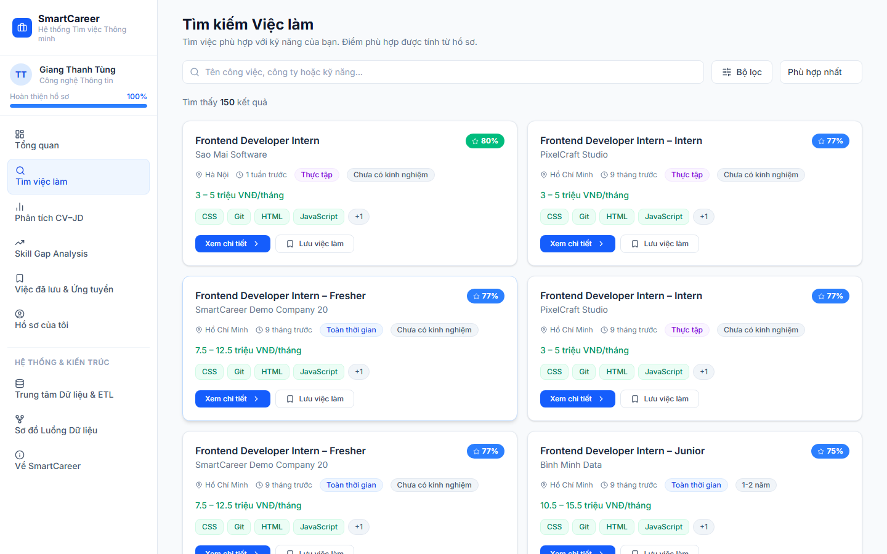

**Phân tích CV–JD** cho chọn một trong bảy mô hình M0–M6 (danh sách bên trái luôn hiển thị điểm M3 mặc định), hiển thị sáu điểm thành phần, kỹ năng có và thiếu cùng câu giải thích. Khi chọn M4–M6 mà chưa huấn luyện, lỗi hiện ngay trong khung chọn mô hình và các mô hình khác vẫn dùng được.

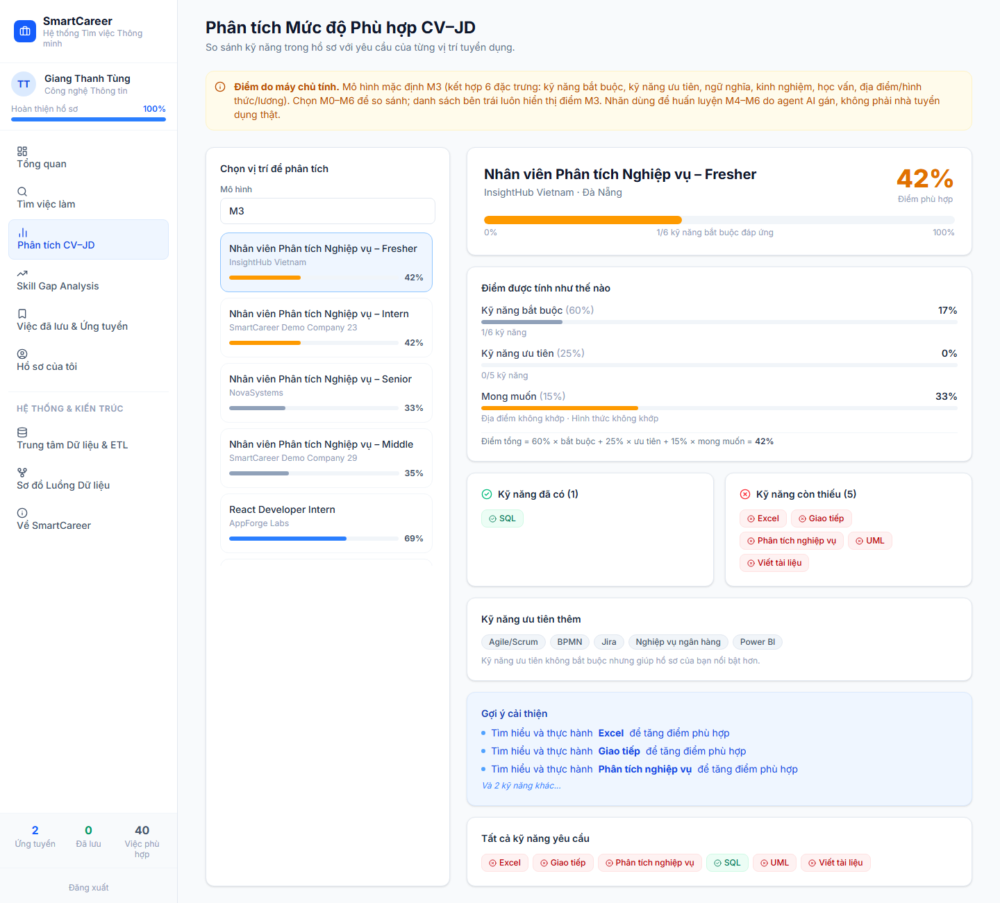

**Skill Gap** liệt kê kỹ năng còn thiếu của tin mục tiêu (bắt buộc trước, ưu tiên sau) kèm lộ trình học 3 bước lấy từ API, và cho đánh dấu đã học.

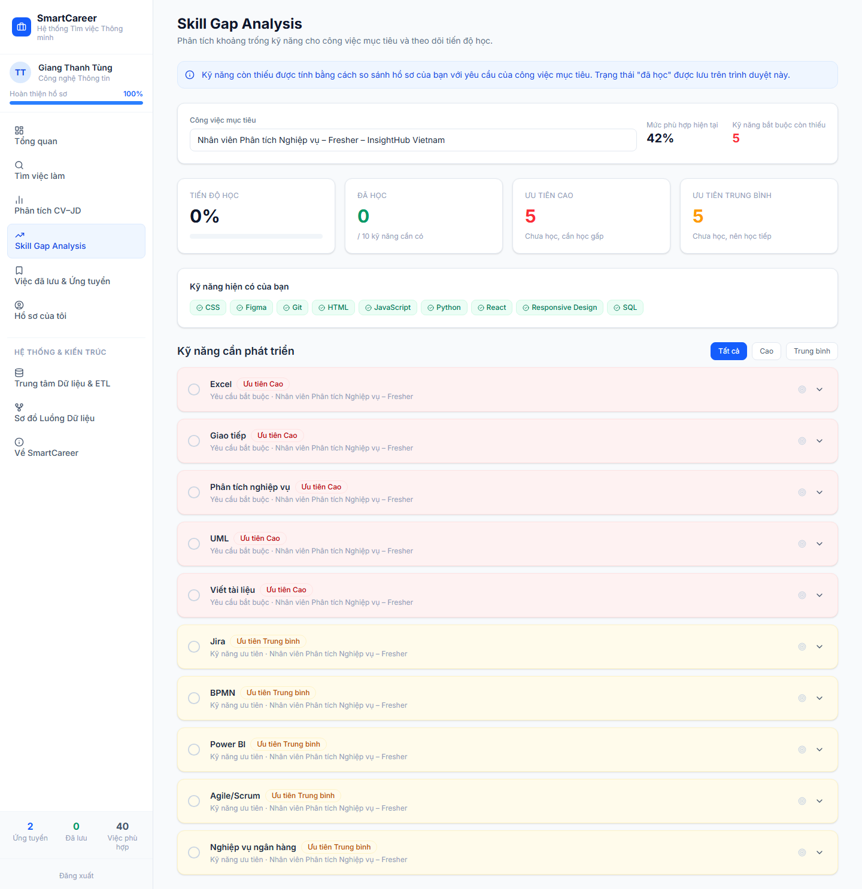

**Hồ sơ và tải CV.** Ứng viên tải CV (PDF/DOCX/TXT), phải tích ô đồng ý xử lý dữ liệu; hệ thống đề xuất kỹ năng để ứng viên chọn hoặc bỏ. Kỹ năng gợi ý từ embedding được đánh dấu "gợi ý" và không tự chọn. Lỗi tải (thiếu đồng ý, sai định dạng, quá 5 MB, CV rỗng) hiển thị bằng thông báo tiếng Việt.

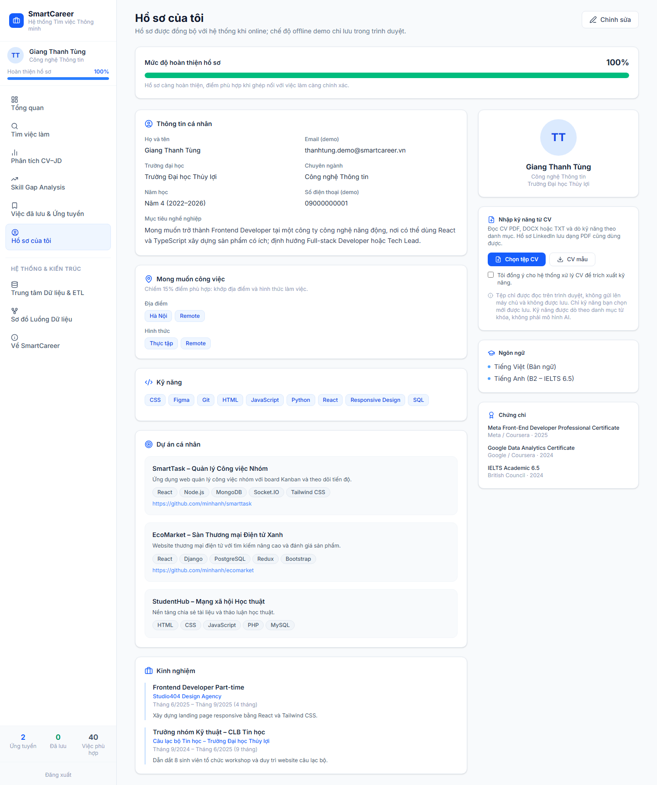

**Ứng tuyển và theo dõi.** Nút "Ứng tuyển" gửi đơn lên máy chủ; nộp trùng hiển thị "Bạn đã ứng tuyển tin này rồi." thay vì báo thành công. Ở tab "Đang theo dõi", ứng viên chỉ **xem** trạng thái đơn (6 giá trị: Đã ứng tuyển, Đang xem xét, Phỏng vấn, Đề nghị nhận việc, Đã nhận việc, Đã từ chối); việc đổi trạng thái là quyền của nhà tuyển dụng.

## 4. Giao diện nhà tuyển dụng

**Quản lý tin** liệt kê tin của công ty, cho sửa và đóng tin.

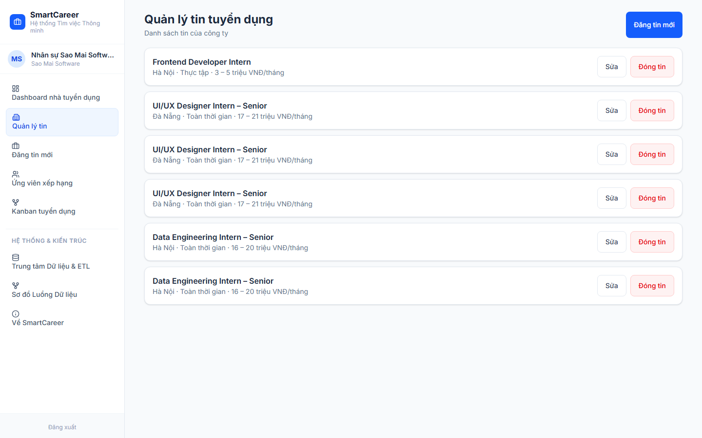

**Đăng tin** có nút "Gợi ý kỹ năng từ mô tả": hệ thống trích kỹ năng từ mô tả (qua `POST /ai/extract-skills`), nhà tuyển dụng chọn từng kỹ năng là bắt buộc hay ưu tiên. Form giữ nguyên cấp bậc và số năm kinh nghiệm khi sửa tin.

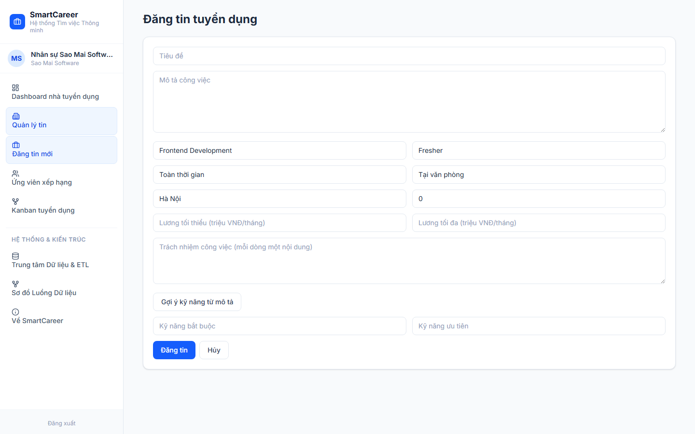

**Ứng viên xếp hạng** hiển thị các ứng viên đã nộp vào một tin, xếp theo điểm khớp giảm dần, kèm lý do khớp và kỹ năng thiếu.

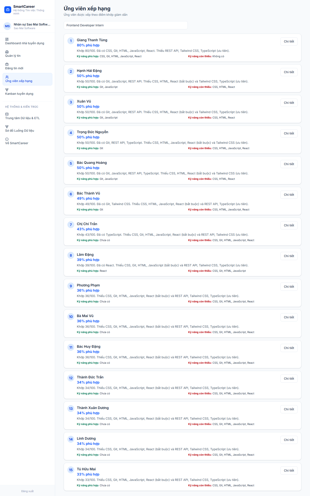

**Kanban tuyển dụng** có 6 cột theo trạng thái. Mỗi thẻ chỉ có các nút chuyển hợp lệ (bước kế tiếp hoặc Từ chối); chuyển sai luật bị backend từ chối (409 `invalid_transition`) và giao diện hiển thị lỗi. Mỗi lần chuyển được ghi vào lịch sử trạng thái.

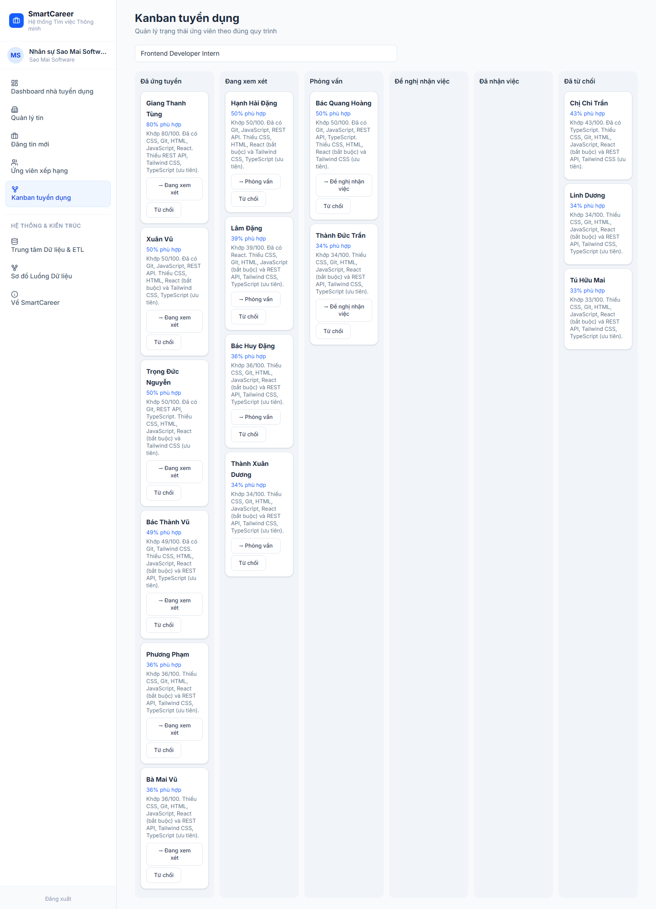

**Dashboard** hiển thị bốn số tổng quan và ba biểu đồ (cung – cầu kỹ năng, xu hướng lương, phễu tuyển dụng); xem chi tiết và số liệu ở chương BI. Khi đã dựng dashboard (`bi/superset/bootstrap.py`), phần trên là dashboard Superset nhúng (6 biểu đồ, giới hạn theo công ty bằng RLS) và phần dưới là biểu đồ dự phòng Recharts. Khi Superset chưa cấu hình, trang chỉ dùng biểu đồ dự phòng và ghi chú rõ; lỗi của từng nguồn dữ liệu chỉ ảnh hưởng đúng khối của nó.

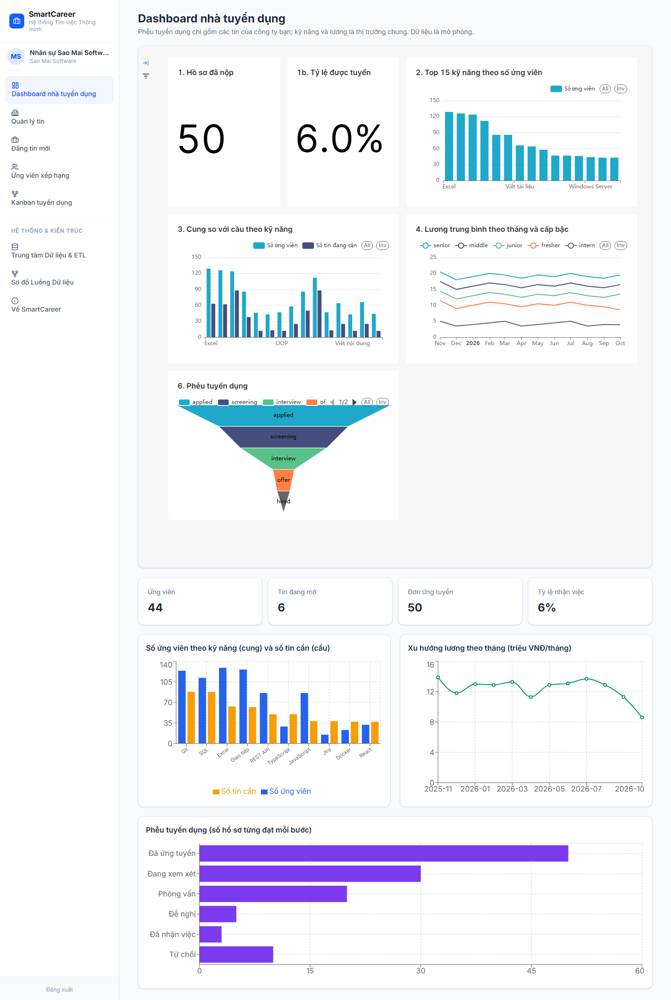

## 5. Giao diện quản trị viên

Trang **Quản lý kỹ năng** (chức năng F10) cho quản trị viên xem danh mục kỹ năng theo nhóm, thêm hoặc sửa kỹ năng cùng lộ trình học, và thêm hoặc xoá từ đồng nghĩa (alias). Từ đồng nghĩa mới có hiệu lực ngay ở bộ trích kỹ năng (ví dụ thêm `reakt` → React thì "Gợi ý kỹ năng" ở form đăng tin nhận ra).

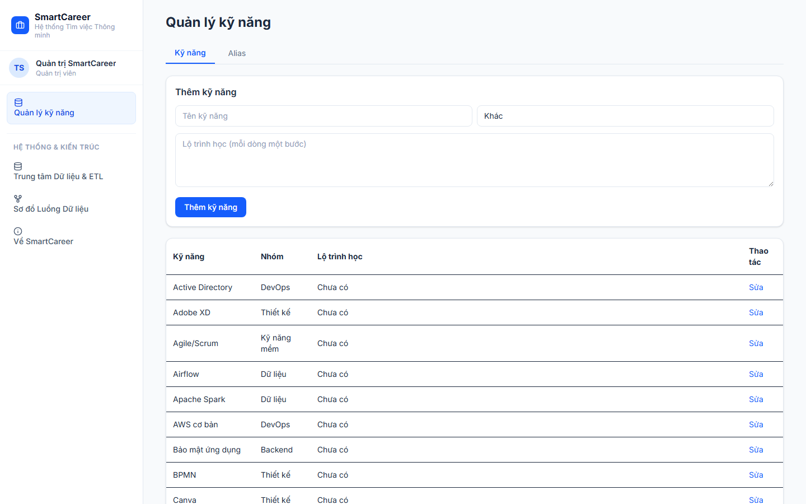

## 6. Tích hợp API

| Nhóm | Endpoint chính | Dùng ở |
|---|---|---|
| Xác thực | `POST /auth/register`, `/auth/login`, `GET /auth/me` | đăng nhập, đăng ký |
| Hồ sơ, CV | `GET/PUT /candidates/me`, `PUT /candidates/me/skills`, `POST /resumes/upload` | Hồ sơ |
| Tin | `GET /jobs` (phân trang, lọc), `POST/PUT/DELETE /jobs` | Tìm việc, Quản lý tin, Đăng tin |
| AI | `POST /ai/match`, `GET /candidates/me/matches`, `/recommendations`, `/skill-gap`, `GET /jobs/{id}/ranked-candidates`, `POST /ai/extract-skills` | Phân tích, Tổng quan, Skill Gap, Xếp hạng, Gợi ý kỹ năng |
| Ứng tuyển | `POST /applications`, `GET /applications/me`, `PATCH /applications/{id}/status`, `/saved-jobs` | Ứng tuyển, Kanban |
| BI | `GET /bi/summary`, `/bi/skills`, `/bi/salary`, `/bi/funnel`, `/bi/guest-token` | Dashboard |
| Quản trị | `/admin/skills`, `/admin/skill-aliases` | Quản lý kỹ năng |

Mọi màn có đủ ba trạng thái: đang tải, lỗi (có nút thử lại) và rỗng. Lỗi từ backend được dịch ra thông báo tiếng Việt (ví dụ `already_applied` → "Bạn đã ứng tuyển tin này rồi."). Thời gian backend trả không kèm múi giờ (UTC) nên giao diện thêm `Z` trước khi hiển thị.

## 7. Kiểm thử giao diện

`scripts/e2e_ui.py` (Playwright) chạy hai bộ kịch bản:

- **Online**, trên backend thật: **16/16 bước đạt** (đã gồm khung Superset nhúng không gọi API bị từ chối): đăng nhập ba vai trò, tải đủ trên 100 tin, nút "Ứng tuyển", ứng tuyển thành công, nộp trùng hiện lỗi, đơn ở bước "offer" hiển thị "Đề nghị nhận việc" trong "Đang theo dõi", Skill Gap có lộ trình, dashboard có ba biểu đồ và phễu, nhà tuyển dụng không gọi API của ứng viên, admin bị chặn khỏi trang nhà tuyển dụng, không lỗi JavaScript. (Lần chạy 06/11/2026 trên stack Docker của nhánh sửa, model embedding thật.)
- **Offline**, không backend: **19/19 bước đạt**, gồm 12 trang của ba vai trò mở được, Kanban demo chuyển được trạng thái, dashboard demo có biểu đồ, và **0 lời gọi API**.

Lệnh chạy và điều kiện (nạp dữ liệu sạch trước mỗi lần, vì ứng viên demo chỉ ứng tuyển được một lần mỗi tin) nằm ở đầu `scripts/e2e_ui.py`.

## 8. Hạn chế

- Dashboard Superset nhúng đã kiểm với Superset thật nhưng chưa có Native Filter; lỗi tải khung nhúng thì trang tự dùng biểu đồ dự phòng.
- Màn nhà tuyển dụng ở chế độ demo dùng dữ liệu mẫu (ứng viên, số liệu BI), không phải dữ liệu từ máy chủ.
- Chưa có kiểm thử đơn vị cho từng thành phần giao diện; việc kiểm thử dựa trên kịch bản trình duyệt tự động và kiểm tra thủ công.
- Chi tiết CV đầy đủ của ứng viên chưa hiển thị ở màn nhà tuyển dụng vì API xếp hạng chỉ trả điểm, lý do khớp và danh sách kỹ năng.
